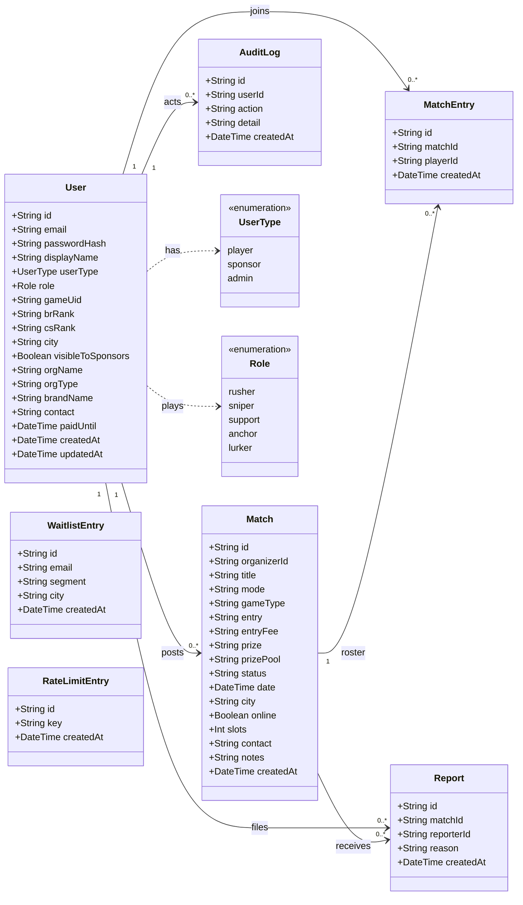
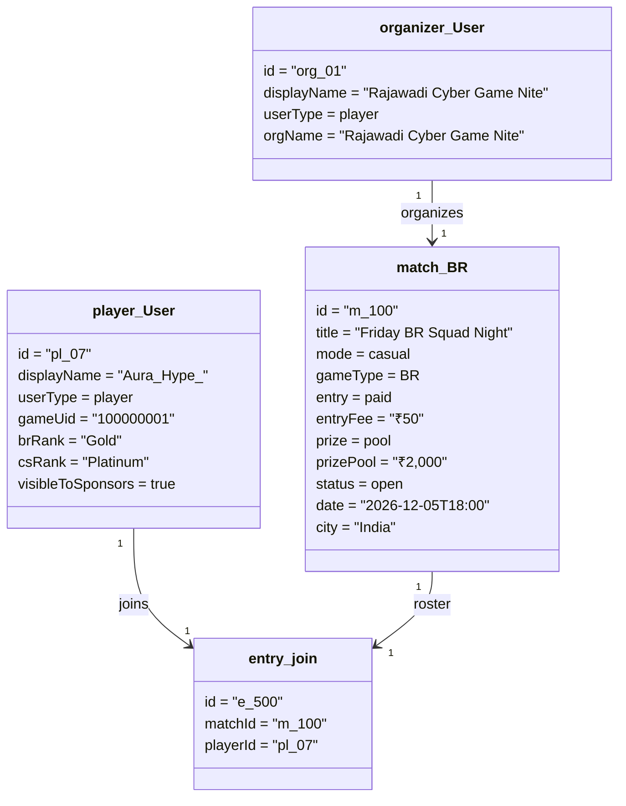

# Match Platform — UML

Class diagram for the current free-entry model (product truth: `SPEC.md`). Verified-pool entities (`VerificationProof`, `verified`, `rank`, `moderator`) are intentionally absent.

## Taxonomy (value sets)

| Field | Values |
|---|---|
| `Match.mode` | `casual` · `competitive` · `ranked` · `esports` |
| `Match.gameType` | `BR` · `CS` · `BR/CS` |
| `Match.entry` | `free` · `paid` |
| `Match.prize` | `none` · `pool` |
| `Match.status` | `open` · `closed` |
| `User.userType` | `player` · `organizer` · `sponsor` · `admin` |

`entryFee` / `prizePool` are **notes** (e.g. `₹50`), never amounts the platform collects.

## Relationships and rules

| Rule | Where enforced |
|---|---|
| One organizer posts many matches; a match belongs to one organizer | `Match.organizerId` |
| A player joins a match at most once | `@@unique([matchId, playerId])` on `MatchEntry` |
| Deleting a match removes its roster | `onDelete: Cascade` |
| A closed match accepts no joins | join action checks `Match.status` |
| A player reports a match at most once | `@@unique([matchId, reporterId])` on `Report` |
| The poster sees the roster (name, UID, email, ranks) | roster query scoped to `Match.organizerId` |
| Sponsor-facing profile fields are legacy and unused | no sponsor directory or export query exists |

## Object diagram (one instance of the flow)

